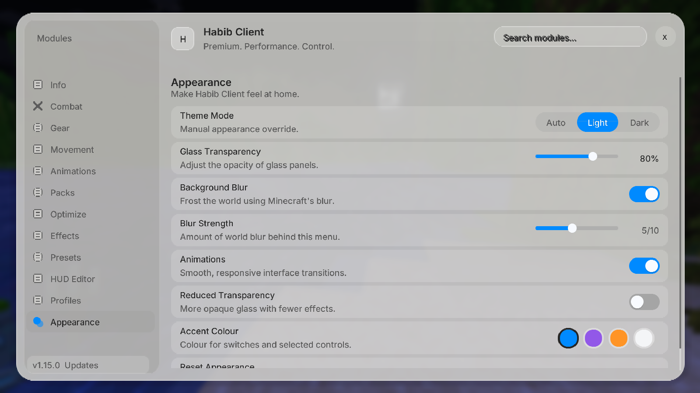
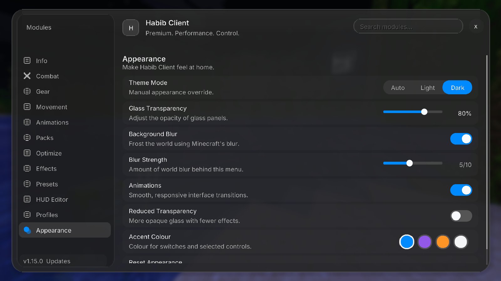
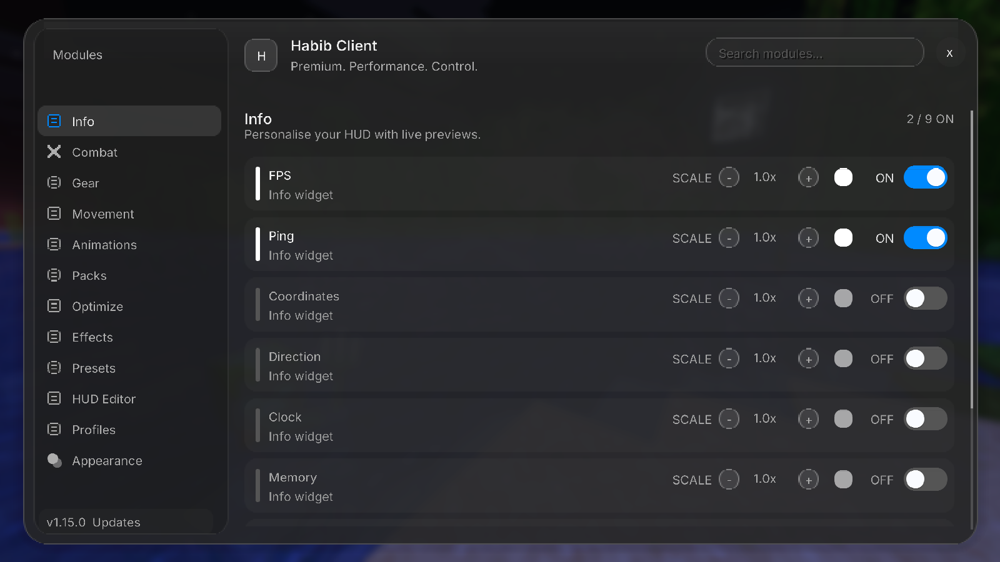
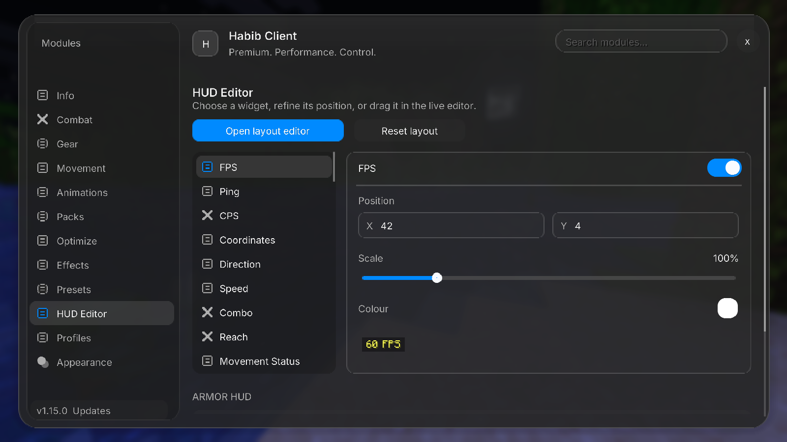
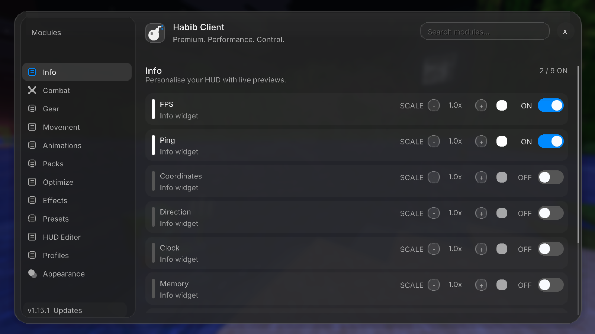
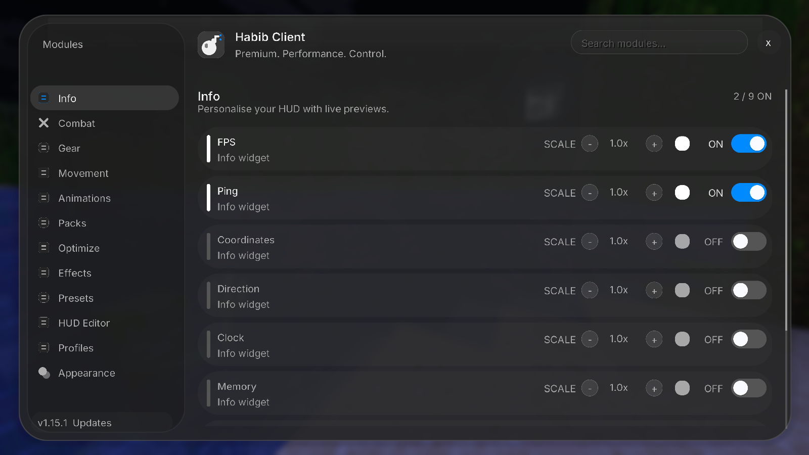

# Liquid Glass UI

The 1.21.11 build uses Yarn/Java 21; the 26.2 build uses Mojang names/Java 25. The shared source set contains appearance data, palette interpolation and OS detection. Version-specific GlassRenderer and MenuBlurMixin adapters use each version's GUI and vanilla blur APIs. UiTypography delegates to Minecraft-managed glyph storage. Inter-derived regular and semibold font assets are local to Habib screens; their atlas sampling is linear, while vanilla fonts and item textures keep their existing filtering. Round corners use two shared, linearly filtered nine-slice masks, generated by tools/prepare_ui_shapes.py. No new runtime library or custom framebuffer is required.

## Verification

Run ./gradlew build at the repository root with Java 21, and in versions/mc26.2 with Java 25. Each build runs verifyAppearance, a dependency-free assertion runner covering older-config defaults, JSON persistence, invalid values, palette endpoints, alpha composition, readable accent text, system detection or fallback, motion consistency at 30/60/144 FPS, spring overshoot and settling, and bundled font/license/shape presence.

Isolated Minecraft 1.21.11 and 26.2 development launches exercised custom-font glyph loading, scaled search-field focus, search filtering, sidebar navigation, HUD position field focus and updates, slider dragging, content scrolling, armor dropdown selection and the reset modal. A duplicate blur request found during that launch was corrected by using Screen's background hook exactly once. Temporary preview instrumentation is not part of the distributable.

After integrating the current main branch, both clients passed Camera/FOV control and sidebar-fit checks (including a small 26.2 window). Incorrect FOV accessor field types found during startup were corrected.

The spring opening was also checked in both development clients: it peaked about 1% above the final size and settled, while search focus, sidebar clicks and slider dragging stayed aligned. Disabling animations snapped to the final position.

Windows application-theme detection was exercised locally. macOS and Linux detection have not been tested on those operating systems. Shader-pack combinations, multiplayer interactions, ultrawide displays and comparative FPS profiling still need user testing. Both version-specific font adapters and their menu rendering were also exercised in these isolated development clients.

## Review checklist

- Open Right Shift at several GUI scales, including a small window.
- Compare Light and Dark, then choose Auto and change the desktop application appearance.
- Exercise module switches, scale and colour, animation settings, packs, optimizers, effects, presets and profile sharing.
- In HUD Editor, change coordinates, scale and armor dropdowns; open the full-screen editor and drag, resize and recolour a widget.
- Toggle blur, reduced transparency and animations, and verify the preferences after restart and profile loading.
- Merge the feature PR only after review. The existing main-branch workflow then builds and publishes 1.15.5 for both Minecraft versions; installed clients receive it through the existing updater after the release succeeds.

## Development screenshots

These are actual Minecraft 1.21.11 development screenshots at 1600 x 900. They were captured before the 1.15.1 version increment. Small-window behavior was also exercised at 854 x 480.

The menu header uses a geometric cartoon bomb mark. The screenshot below shows it in the isolated 1.21.11 client.

The rounded controls are shown below, captured in the 1.21.11 development client after the spring settles.

